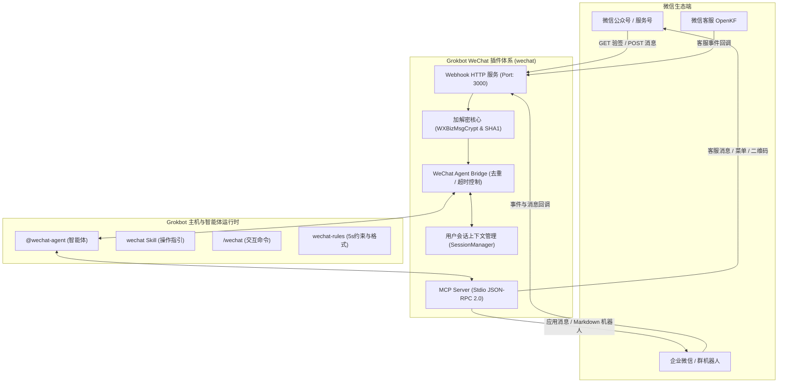

# Grokbot WeChat 插件 (`wechat`)

> 基于 **Grokbot 插件市场规范** 与 **微信官方接口标准** 构建的微信生态全能力智能体对接插件。

[](#)
[](#)
[](#)
[](#)
[](#)

---

## 🌟 特性一览

1. **全面遵循 Grokbot 插件市场标准**：
   - 具备 `.cursor-plugin/plugin.json` 与 `.cursor-plugin/marketplace.json` 完整清单定义。
   - 包含变量规范（`variables` JSON Schema）、技能（`skills`）、专有智能体（`agents`）、交互指令（`commands`）、交互约束（`rules`）、生命周期钩子（`hooks`）及 MCP 服务（`mcpServers`）。
2. **完整的微信生态接口打通**：
   - **微信公众号 / 服务号**：开发者模式 Webhook 认证（GET）、消息与事件接收、被动快速回复、客服消息主动下发、带参二维码生成、自定义菜单管理。
   - **企业微信 (WeCom)**：企业自建应用消息推送（支持微信特化 Markdown）、群机器人 Webhook 告警。
   - **微信客服 (OpenKF)**：客服消息同步与对外回复。
3. **安全加密与标准协议支持**：
   - 内置纯原生实现的 `WXBizMsgCrypt`，支持 AES-256-CBC 算法、PKCS#7 块填充与 SHA-1 签名校验，保障生产环境安全模式下数据不泄漏。
4. **独创 5 秒生死线双模响应机制 (Dual-Mode Response Engine)**：
   - **被动即时回复 (<= 4.5s)**：Agent 思考耗时较短时，直接以 XML 结构体完成即时被动回复。
   - **异步客服推送 (> 4.5s)**：大模型长耗时思考时，立即返回空串满足微信 5 秒约束（杜绝微信 3 次重复重试），思考完毕后通过客服消息接口（`custom/send`）异步推送用户。
5. **模型上下文协议 (Model Context Protocol, MCP)**：
   - 提供基于 Stdio JSON-RPC 2.0 的独立 MCP Server，Grokbot 各智能体可原生调用微信相关工具。

---

## 🏛️ 整体系统架构



---

## 📁 目录结构

```
wechat/
├── .cursor-plugin/
│   ├── plugin.json                 # Grokbot 插件元数据与变量声明清单
│   └── marketplace.json            # 插件市场目录注册清单
├── plugin.json                     # 根目录清单兼容项
├── .mcp.json                       # Model Context Protocol 配置
├── package.json                    # 模块与依赖定义
├── tsconfig.json                   # TypeScript 配置 (NodeNext)
├── .env.example                    # 环境变量配置模板
├── skills/
│   └── wechat/
│       └── SKILL.md                # Agent 微信集成操作技能指南
├── agents/
│   └── wechat-agent.md             # 专属微信智能体定义
├── commands/
│   └── wechat.md                   # /wechat 交互命令
├── rules/
│   └── wechat-rules.md             # 微信端时延与排版规则
├── hooks/
│   └── hooks.json                  # SessionStart 钩子探针
├── scripts/
│   └── check-wechat-status.js      # 状态探针检测脚本
├── src/
│   ├── index.ts                    # 插件导出与 CLI 入口
│   ├── types.ts                    # TypeScript 类型定义
│   ├── config.ts                   # 配置解析与加载
│   ├── crypto/
│   │   ├── wx-crypto.ts            # WXBizMsgCrypt (AES-256-CBC + PKCS#7)
│   │   └── signature.ts            # 微信签名计算与校验
│   ├── utils/
│   │   ├── xml.ts                  # 高性能 XML 解析与构建
│   │   └── cache.ts                # TTL 缓存与消息去重
│   ├── adapter/
│   │   ├── official-account.ts     # 微信公众号 API 适配器
│   │   ├── wecom.ts                # 企业微信 API 适配器
│   │   └── openkf.ts               # 微信客服 API 适配器
│   ├── agent/
│   │   ├── session.ts              # 会话记忆与上下文管理
│   │   └── bridge.ts               # Agent 桥接调度核心
│   ├── server/
│   │   └── webhook-server.ts       # 原生 HTTP Webhook 服务
│   └── mcp/
│       ├── tools.ts                # MCP 工具定义与执行器
│       └── index.ts                # MCP Stdio 服务启动器
├── tests/
│   ├── manifest.test.mjs           # 清单规范测试
│   ├── crypto.test.mjs             # 加解密与签名测试
│   ├── xml.test.mjs                # XML 序列化与解析测试
│   ├── webhook.test.mjs            # Webhook 验签与回调测试
│   └── mcp.test.mjs                # MCP 工具与 JSON-RPC 通信测试
└── docs/
    ├── API.md                      # 微信生态与智能体对接详细规范
    └── GROKBOT_INTEGRATION.md      # Grokbot 插件体系装载规范
```

---

## ⚙️ 配置说明

在根目录下创建 `.env` 文件（或直接在 Grokbot 插件配置界面中设置变量）：

```ini
# ==========================================
# 微信公众号 (Official Account)
# ==========================================
WECHAT_APP_ID=wx1234567890abcdef
WECHAT_APP_SECRET=0123456789abcdef0123456789abcdef
WECHAT_TOKEN=your_custom_verification_token
WECHAT_AES_KEY=your_43_character_encoding_aes_key_here12345

# ==========================================
# 企业微信 (WeCom，可选)
# ==========================================
WECOM_CORP_ID=ww1234567890abcdef
WECOM_CORP_SECRET=your_wecom_app_secret
WECOM_AGENT_ID=1000002
WECOM_BOT_WEBHOOK=https://qyapi.weixin.qq.com/cgi-bin/webhook/send?key=your_bot_key

# ==========================================
# Webhook 服务设置
# ==========================================
WECHAT_WEBHOOK_PORT=3000
WECHAT_WEBHOOK_HOST=0.0.0.0
WECHAT_WEBHOOK_PATH=/wechat/webhook

# ==========================================
# Agent 响应控制
# ==========================================
AGENT_PASSIVE_REPLY_TIMEOUT_MS=4500
AGENT_SESSION_CONTEXT_LIMIT=10
```

---

## 🚀 编译与运行

### 1. 克隆与安装依赖
```bash
git clone git@github.com:manifoldor/wechat.git
cd wechat
npm install
npm run build
```

### 2. 执行自动化测试
```bash
npm test
```
全部 12 项单元与端到端测试均将通过：
- ✅ 清单校验与 Grokbot 规范测试
- ✅ 微信 SHA-1 签名与 Token 认证测试
- ✅ `WXBizMsgCrypt` 对称加解密与 `msg_signature` 校验测试
- ✅ XML 解析、CDATA 提取与被动回复封装测试
- ✅ 真实 HTTP Webhook GET 验签与 POST 回调测试（包含明文与安全加密两种模式）
- ✅ MCP Server Stdio JSON-RPC 2.0 通信与工具列表测试

### 3. 启动 Webhook 服务
```bash
npm run server
```
启动后可在外网通过 HTTPS 访问 `https://your-domain.com/wechat/webhook`。微信公众号后台配置“服务器地址 (URL)”即完成接入。

### 4. 启动 MCP 服务
```bash
npm run mcp
```
Grokbot 在装载 `.mcp.json` 时会自动管理此进程的生命周期。

---

## 🛠️ MCP 工具集合 (Agent 可用)

| 工具名称 | 输入参数 | 功能描述 |
| :--- | :--- | :--- |
| `wechat_send_text` | `toUser`, `content`, `channel?` | 向微信用户发送文本消息（自动选用公众号或企微） |
| `wechat_send_markdown` | `content`, `toUser?`, `useWebhook?` | 向企微应用或群机器人发送 Markdown 富文本 |
| `wechat_send_custom_service_msg` | `openId`, `content` | 通过公众号客服接口主动推送异步长文本答案 |
| `wechat_get_user_info` | `openId`, `lang?` | 获取用户昵称、城市、头像等公开资料 |
| `wechat_create_qrcode` | `sceneStr`, `expireSeconds?` | 创建带参数的临时渠道二维码 |
| `wechat_manage_menu` | `action ("get"\|"create")`, `menuData?` | 查询或发布微信公众号自定义菜单 |
| `wechat_get_token` | `forceRefresh?` | 查看或刷新全局微信 Access Token 状态 |

---

## 💬 Grokbot 交互指南

### 1. 专属智能体调用
在 Grokbot 聊天窗口中输入：
```
@wechat-agent 帮我给昨天关注公众号的用户发送一份新功能使用指南，并生成一个引流二维码。
```

### 2. 斜杠命令控制
- `/wechat status`: 查看当前微信公众号与企微连接状态及 Token 剩余有效期。
- `/wechat send <toUser> <content>`: 主动发送测试消息。
- `/wechat server`: 启动本地 Webhook 接收服务。
- `/wechat menu get`: 导出线上当前公众号菜单配置。

---

## 📄 授权许可
MIT License.
