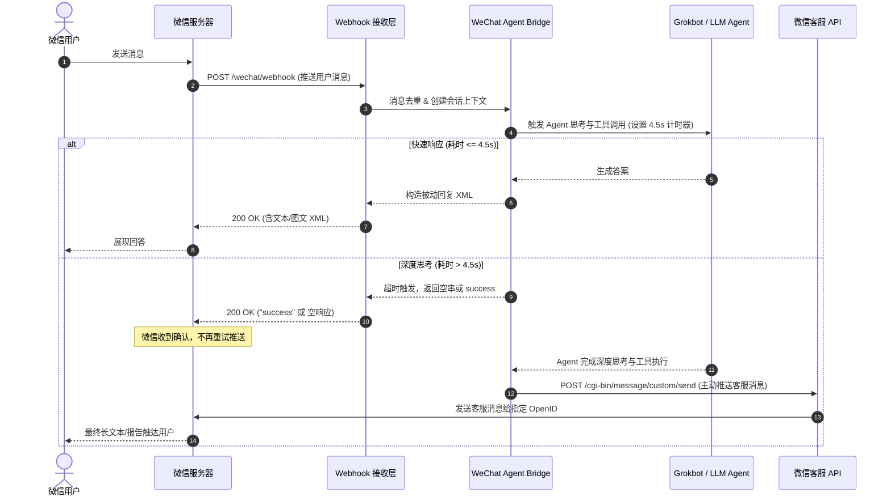

# 微信生态与智能体 (Agent) 对接接口规范

本规范详细说明本插件如何实现微信生态（微信服务号/公众号、企业微信、微信客服）与 AI Agent 的全链路打通。

---

## 1. 微信服务器接入与签名校验

### 1.1 GET 校验请求 (URL 认证)
微信公众号在设置 Webhook 时，会向填写的 URL 发送 HTTP GET 请求以验证服务器有效性。

**Query 参数：**
- `signature`: 微信加密签名，结合了开发者填写的 `token` 参数和请求中的 `timestamp`、`nonce`
- `timestamp`: 时间戳
- `nonce`: 随机数
- `echostr`: 随机字符串

**校验算法：**
```
1. 将 token、timestamp、nonce 三个参数进行字典序排序；
2. 将三个参数字符串拼接成一个字符串进行 sha1 加密；
3. 开发者获得加密后的字符串可与 signature 对比，标识该请求来源于微信；
4. 若一致，直接原样返回 echostr 内容；否则返回 403。
```

---

## 2. 消息加解密方案 (WXBizMsgCrypt)

在生产环境中推荐配置**安全模式**（AES-256-CBC 加密）。

### 2.1 密钥参数
- `EncodingAESKey`: 微信后台生成的 43 位 Base64 编码字符串。
  - 解码方式：`AESKey = Base64_Decode(EncodingAESKey + "=")`，长度为 32 字节。
  - IV 向量：取 `AESKey` 前 16 字节。
- 填充方式：PKCS#7 填充，块大小为 32 字节（微信规范）。

### 2.2 解密流程
1. 提取密文 XML 中的 `<Encrypt>` 节点内容（Base64 编码）。
2. 计算消息签名比对：
   `msg_signature == SHA1(sort([token, timestamp, nonce, encrypt]).join(""))`
3. 使用 AES-256-CBC 算法解密密文，去除 PKCS#7 填充。
4. 拆解明文字节流：
   - 0~15 字节：16 字节随机字符串（丢弃）
   - 16~19 字节：4 字节网络字节序（大端序）的正文消息长度 `msg_len`
   - 20 ~ (20 + msg_len) 字节：XML 消息正文明文
   - 剩余字节：发送方的 `AppID` 或 `CorpID`（用于校验来源真实性）

---

## 3. Agent 核心交互流：5 秒生死线与双模回复机制

微信服务器要求开发者服务器在 **5 秒内** 做出 HTTP 响应。而大语言模型（LLM）由于深度推理或联网搜索，耗时常超过 5 秒。

本插件独创了**双模响应架构 (Dual-Mode Response Engine)**：



---

## 4. 关键 API 接口汇总

| 接口分类 | 接口路径 / 名称 | 协议 | 描述 |
| :--- | :--- | :--- | :--- |
| **凭证管理** | `/cgi-bin/token` | HTTPS GET | 获取公众号全局 `access_token` (缓存 7200s) |
| **客服消息** | `/cgi-bin/message/custom/send` | HTTPS POST | 主动向 48h 内活跃的微信用户推送图文/文本 |
| **用户画像** | `/cgi-bin/user/info` | HTTPS GET | 根据 OpenID 查询用户基本资料 |
| **渠道二维码** | `/cgi-bin/qrcode/create` | HTTPS POST | 创建带参数的临时二维码 (用于 Agent 场景绑定) |
| **自定义菜单** | `/cgi-bin/menu/create` | HTTPS POST | 配置并发布公众号底部快捷入口 |
| **企微应用消息** | `/cgi-bin/message/send` | HTTPS POST | 企业微信自建应用向内部员工推送 Markdown 报告 |
| **企微群机器人** | `qyapi.weixin.qq.com/cgi-bin/webhook/send` | HTTPS POST | 向群聊推送实时告警与 Markdown 消息 |
| **微信客服** | `/cgi-bin/kf/send_msg` | HTTPS POST | 微信客服 (OpenKF) 向外部微信访客推送消息 |
